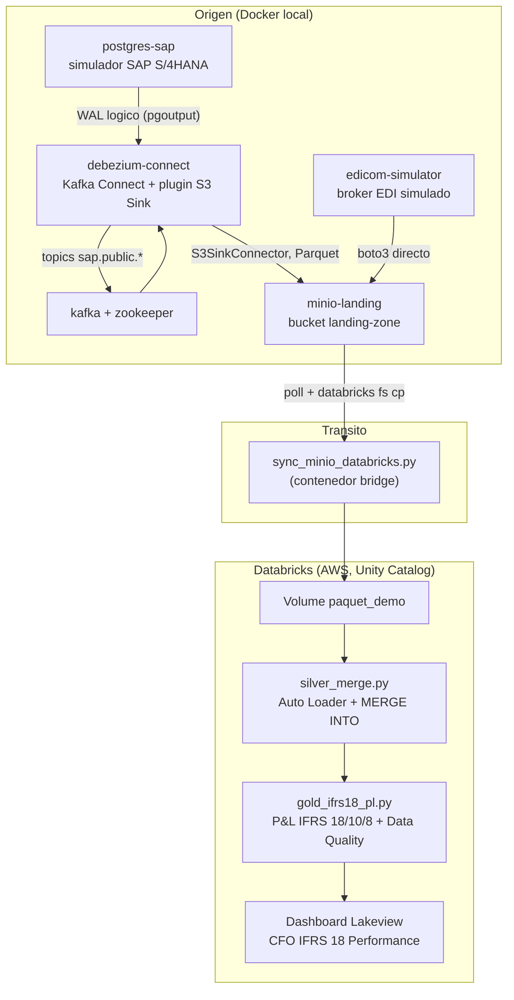

# poc-cdc-databricks

PoC de integración de datos CDC en tiempo real: PostgreSQL (simulador SAP S/4HANA) → Debezium → MinIO (Parquet) → script puente → Databricks (Auto Loader / Delta) → capas Silver/Gold con consolidación financiera IFRS, más una rama independiente Farma Sell-In/Sell-Out.

## Arquitectura general

## Componentes

| Capa | Artefacto | Rol |
|---|---|---|
| Origen | `init.sql`, `generate_financial_data.py`, `generate_farma_data.py` | Esquema y datos simulados en Postgres |
| CDC | `connectors/*.json` | Config Debezium (source Postgres, sink S3/Parquet) |
| Infra | `docker-compose.yml`, `Dockerfile.bridge`, `Dockerfile.edicom` | Orquestación de contenedores locales |
| Tránsito | `sync_minio_databricks.py` | MinIO → Databricks Volume (idempotente, contenedorizado) |
| EDI externo | `edicom_simulator.py` | Simulador de Sell-Out, escribe directo a MinIO |
| Silver | `databricks/silver_merge.py` | Auto Loader + MERGE INTO, upsert/delete CDC |
| Gold | `databricks/gold_ifrs18_pl.py` | P&L IFRS 18, eliminación IFRS 10, segmentos IFRS 8, Data Quality (`CHECK`) |
| Orquestación | `databricks_job.json` | Workflow Silver → Gold en Databricks Jobs |
| BI | `cfo_dashboard_queries.sql`, `create_cfo_dashboard.py` | Consultas CFO + Dashboard Lakeview vía API (BI-as-Code) |
| Enlaces | `get_ui_links.py` | URLs directas a Data Explorer / Job Run / SQL Editor |

## Fase 1 — CDC base (cliente SAP KNA1)

Tabla `sap_clientes_kna1` (`REPLICA IDENTITY FULL`) replicada a `mi_test_catalogo.default.silver_sap_clientes_kna1`. Validado con prueba de negocio Australia→Brasil (insert, update, insert, delete) — ver `CLAUDE.md`, sección "Estado de validación E2E".

## Fase 2 — Consolidación Financiera IFRS

Simulación del Universal Journal (`acdoca`) y maestros (`vbrk`, `vbrp`, `ifrs18_fsv_map`): 5000 líneas contables (2500 Australia / 2500 Brasil), con:
- **IFRS 10** — transacciones intercompany AU→BR marcadas vía `RASSC`, eliminadas en el P&L consolidado.
- **IFRS 8** — reporte por segmento/sociedad (`RBUKRS`), Operating Profit y EBITDA ajustado AU vs BR.
- **IFRS 18** — categorización obligatoria de cuentas (`Operating`/`Investing`/`Financing`/`Taxes`), incluyendo cuentas de diferencia de cambio (FX) mapeadas explícitamente según su origen, y reconciliación de MPM (EBITDA ajustado) vía `MPM_TAG`.

Resultado persistido en `mi_test_catalogo.default.gold_acdoca_ifrs18` (tabla gobernada con `CHECK` constraints) y expuesto en el Dashboard "CFO IFRS 18 Performance".

## Fase 3 — Farma: Sell-In vs Sell-Out

Nueva rama de negocio, independiente del modelo financiero, para conciliar lo que SAP **entrega** a las farmacias (Sell-In) contra lo que el broker EDI **reporta vendido** en el punto de venta (Sell-Out):

- **`farma_sell_in`** (Postgres/SAP): entregas a farmacias — `MATNR`, `WERKS`, `LOTE`, cantidad en cajas, fecha. ~1 año de historia.
- **`map_sku`** (Postgres/SAP): homologación `MATNR` → `EAN13` (EDICOM) + factor de conversión cajas→blísteres.
- **`map_cedi`** (Postgres/SAP): homologación `WERKS` → `GLN` (EDICOM) + flag `is_commercial` (excluye CEDIs de cross-docking, que no reportan Sell-Out real).
- **`edicom_simulator.py`** (contenedor independiente): simula el broker EDI externo, generando mensajes de Sell-Out (`GLN`, `EAN13`, cantidad en blísteres, lote, fecha) **directo a `s3://landing-zone/edicom/`**, sin pasar por Debezium/Kafka — representa una fuente externa real, desacoplada de SAP.

La conciliación Sell-In (cajas, vía CDC) vs Sell-Out (blísteres, vía EDI) y el cruce `map_sku`/`map_cedi` quedan para la capa Silver/Gold de una fase posterior (no incluida en este corte).

## Decisiones de arquitectura relevantes

- **CDC de nuevas tablas**: agregar una tabla a `table.include.list` de un conector Debezium ya corriendo **no** recupera datos insertados antes del cambio (la publicación de Postgres solo decodifica lo que ya estaba incluida en el momento de escribir el WAL). Por eso cada extensión de esquema (Fase 2, Fase 3) recrea el conector fuente con un `slot.name` nuevo para forzar un snapshot inicial completo. El conector sink sí tolera un `PUT` incremental (gracias a `consumer.override.auto.offset.reset=earliest`).
- **`ts_ms` de Debezium vs columnas de negocio**: el ordenamiento/deduplicación CDC usa siempre el `ts_ms` de nivel raíz del envelope (tiempo de captura), nunca una columna `ts_ms` de la tabla origen.
- **BI-as-Code**: dashboards de Databricks se generan 100% vía API REST (Lakeview), sin pasos manuales en la UI — ver `create_cfo_dashboard.py`.

Detalle operativo completo (comandos exactos, IDs de jobs/warehouses, incidentes resueltos y sus fixes) en [`CLAUDE.md`](./CLAUDE.md).
